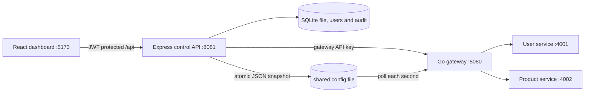

# Gatekeeper

**Smarter Traffic. Faster Responses. Reliable Systems.**

Gatekeeper is a local API gateway project. Manage routes in the React dashboard, persist them in SQLite, and publish a versioned JSON snapshot that the Go gateway loads while running.

## Architecture



## Stack

- Go standard library: reverse proxy, dynamic routing, request IDs, per-IP rate limits, in-memory GET caching, weighted round robin, health probes, and metrics.
- Node.js 24+: Express control API and built-in `node:sqlite` database.
- React, TypeScript, and Vite: responsive dashboard.
- Node.js sample user and product services.

No Docker, Kubernetes, Redis, PostgreSQL, Prisma, or orchestration is required.

## Requirements

- Windows 10/11 with PowerShell 7 recommended (Windows PowerShell 5.1 also supports the startup script).
- Go 1.23 or newer.
- Node.js 22.5 or newer (`node:sqlite`); Node 24 recommended.
- npm.

Node currently prints its experimental warning when the built-in `node:sqlite` module starts; SQLite persistence and the control API tests work normally.

Install JavaScript packages once from the repository root:

```powershell
npm install
```

## Start the application

From the repository root, start all five processes:

```powershell
./scripts/start-all.ps1
```

Open <http://localhost:5173>. Stop the started processes with `./scripts/stop-all.ps1`. Logs are written under `data/logs/`. Default ports are 8080 (gateway), 8081 (control API), 4001 (users), 4002 (products), and 5173 (dashboard). Configure them with `GATEWAY_LISTEN_ADDR`, `CONTROL_API_PORT`, `USER_SERVICE_PORT`, `PRODUCT_SERVICE_PORT`, and `VITE_PORT`. `SQLITE_FILE` and `GATEWAY_CONFIG_FILE` set the database and shared config file paths. Both services resolve relative paths from the project root. The startup script passes one shared configuration path to the API and gateway.

Set overrides in the current PowerShell session before startup, for example:

```powershell
$env:GATEWAY_LISTEN_ADDR = ':8090'
$env:CONTROL_API_PORT = '8091'
$env:USER_SERVICE_PORT = '4101'
$env:PRODUCT_SERVICE_PORT = '4102'
$env:VITE_PORT = '5174'
./scripts/start-all.ps1
```

To start a process manually, use a separate PowerShell window for each:

```powershell
go -C services/gateway run ./cmd/gateway
npm run dev --workspace @gatekeeper/control-plane
npm run dev --workspace @gatekeeper/dashboard
npm run start --prefix services/user-service
npm run start --prefix services/product-service
```

## Use the gateway

1. In **Services**, add `users` with upstream `http://localhost:4001`.
2. In **Routes**, create `/api/users`, select `PREFIX`, allow `GET, POST`, and leave prefix stripping disabled. Optionally configure requests per minute and cache TTL.
3. Add a `products` service and `/api/products` route at `http://localhost:4002`.

Example requests:

```powershell
Invoke-RestMethod http://localhost:8080/api/users
Invoke-RestMethod http://localhost:8080/api/products
Invoke-RestMethod -Method Post -Uri http://localhost:8080/api/users -ContentType 'application/json' -Body '{"name":"Katherine Johnson","email":"katherine@example.test"}'
Invoke-RestMethod http://localhost:8080/health
# Management metrics require a dashboard access token:
$session = Invoke-RestMethod -Method Post -Uri http://localhost:8081/api/auth/login -ContentType 'application/json' -Body '{"username":"<admin>","password":"<password>"}'
$headers = @{ Authorization = "Bearer $($session.accessToken)" }
Invoke-RestMethod http://localhost:8081/api/gateway/metrics -Headers $headers
Invoke-RestMethod http://localhost:8081/api/routes -Headers $headers
Invoke-RestMethod http://localhost:8081/api/gateway/health -Headers $headers
```

The gateway returns a request ID in `X-Request-ID`. An unmatched or disabled route returns 404; a matching path with a disallowed method returns 405.

## Control API

- `GET /health`
- `GET, POST /api/services`; `PUT /api/services/:id`
- `GET /api/upstreams`; `POST /api/services/:id/upstreams`; `PUT, DELETE /api/upstreams/:id`
- `GET, POST /api/routes`; `PUT, DELETE /api/routes/:id`
- `POST, DELETE /api/routes/:id/adaptive/override` (temporarily set a bounded rate or resume automatic control)
- `GET /api/gateway/config`, `/api/gateway/metrics`, `/api/gateway/health`, `/api/gateway/adaptive`, `/api/gateway/adaptive/history`, `/api/analytics`

Route fields include `path`, `matchMode` (`EXACT` or `PREFIX`), `methods`, `stripPrefix`, optional `rewritePrefix`, `timeoutMs`, `rateLimit` (requests/minute/IP, zero disables), `rateLimitMode` (`FIXED` or `ADAPTIVE`), `adaptiveEnabled`, `minimumRateLimit`, `maximumRateLimit`, `spikeSensitivity`, `recoveryCooldownMs`, `cacheTtlMs` (zero disables), `enabled`, and `serviceId`. Services may have multiple weighted upstream instances.

## Routing and traffic behavior

- The gateway selects the most specific matching path; exact routes win ties. Prefix matches stop at path boundaries (`/api/user` does not match `/api/users`).
- Route changes are stored in SQLite and published as a complete JSON snapshot using atomic rename. The gateway validates each snapshot before replacing its immutable active configuration; rejected snapshots leave the active version in place.
- Weighted upstream selection uses an atomic per-route counter. Health probes run every five seconds and `/api/gateway/health` probes targets on demand. Failed instances are skipped until a later healthy probe. The gateway also stores a `.last-good` snapshot beside its shared config file.
- Rate limits use a concurrency-safe in-memory one-minute sliding window keyed by route and client IP. Client state is capped at 10,000 keys.
- Successful GET responses up to 2 MiB are cached per route and request URI for the configured TTL. Errors and responses with `Set-Cookie` are not cached. The cache is concurrency-safe and capped at 1,000 entries.
- Metrics come from live gateway requests and include requests/sec over a rolling ten-second window, average latency (milliseconds, shown to two decimals), server error rate, expected client errors, status-code distribution, cache hits/misses, and a 60-second time series. The dashboard refreshes gateway metrics and backend health every five seconds.
- The **Traffic Analytics** page charts request volume and average response time, breaks down status codes, and shows each configured upstream's latest health probe result. It uses the same live gateway metrics and route configuration as the overview.

## Adaptive rate limiting

Routes default to **FIXED**, preserving the configured one-minute requests-per-IP window. To enable adaptation, edit a route, select **ADAPTIVE**, set its base rate, minimum and maximum, sensitivity, and cooldown, then enable adaptive enforcement. The maximum must be at least the base rate; the minimum cannot exceed the base. Legacy routes migrate as FIXED and keep their current rate limit.

The engine records route traffic in rolling five-second buckets and keeps a 12-bucket (60-second) EWMA baseline. For the first three evaluation windows the baseline is considered unready, so the configured base limit remains in force. After warmup, a window is a spike when it contains at least 10 requests and its rate is strictly greater than `spikeSensitivity × baseline`. Defaults are sensitivity `2.0`, five-second evaluation, 10 requests per spike window, 25% reduction, minimum 20% of base (rounded up), maximum the base, and 30-second recovery cooldown. Traffic state is evaluated every five seconds. After stable traffic through the cooldown, recovery starts and increases by 5% of the base (at least one request/minute) every cooldown period. The dashboard shows actual baseline and incoming traffic, effective limit, throttles, state, last adaptation, and the latest 500 decision explanations.

Administrators can temporarily override a route's effective limit from **Adaptive Protection**. Overrides must remain between the route's configured minimum and maximum and expire after 1–86,400 seconds. Removing an override resumes automatic control. Every route change, override, spike, reduction, and recovery adjustment is applied through the same versioned snapshot reload without restarting Go. `X-RateLimit-Limit`, `X-RateLimit-Remaining`, and `X-RateLimit-Mode` accompany limited route responses; rejected requests include `Retry-After` and a JSON reason.

The engine intentionally keeps traffic baselines, effective limits, and audit events in gateway memory. A gateway restart begins a fresh baseline warmup. This in-memory limiter does not coordinate limits across multiple gateway processes. Recovery advances when traffic is evaluated on subsequent requests.

## Reliability and performance checks

The gateway tests exercise per-client/per-route sliding-window limits (including the JSON 429 and `Retry-After`), cache hit/expiry/configuration invalidation and exclusions, configuration reload, concurrent traffic, weighted round robin, unhealthy target exclusion/recovery, route isolation, upstream failure, and timeout handling.

Run the automated checks from the repository root in PowerShell:

```powershell
$env:GOCACHE = Join-Path (Get-Location) '.gocache'
go -C services/gateway test ./...
go -C services/gateway vet ./...
npm run test:control-api
npm run test:sample-services
npm run typecheck --workspace @gatekeeper/control-plane
npm run lint --workspace @gatekeeper/control-plane
npm run typecheck --workspace @gatekeeper/dashboard
npm run lint --workspace @gatekeeper/dashboard
npm run build --workspace @gatekeeper/dashboard
```

On Windows, the Go race detector requires cgo and a supported C compiler such as MinGW-w64 GCC:

```powershell
$env:CGO_ENABLED = '1'
go -C services/gateway test -race ./...
```

For a repeatable cache-on/cache-off load comparison, start the app with `./scripts/start-all.ps1`, create and enable a route in the dashboard, and copy its ID from the Routes page/API. The load runner works in Windows PowerShell 5.1 and PowerShell 7:

```powershell
./scripts/load-test.ps1 -RouteId '<route-id>' -Iterations 500 -Concurrency 20
```

The script reports requests/sec, average and P95 latency, non-2xx error rate, and gateway cache hit/miss deltas for both modes. It temporarily disables rate limiting for the selected route and restores its prior route settings even if the run fails. Optional parameters are `-CacheTtlMs`, `-ControlApiUrl`, and `-GatewayUrl`.

To reproduce the adaptive traffic burst and recovery scenario, start the app, identify two routes (the script uses one user route and one independent route), then run:

```powershell
$routes = Invoke-RestMethod http://localhost:8081/api/routes
$users = $routes | Where-Object path -eq '/api/users' | Select-Object -First 1
$products = $routes | Where-Object path -eq '/api/products' | Select-Object -First 1
./scripts/test-adaptive.ps1 -RouteId $users.id -OtherRouteId $products.id
```

The script temporarily sets a 20/minute base, establishes four baseline samples, sends a 15-request burst from an isolated loopback client, checks spike detection, the reduced limit and 429 response, verifies the product route, then measures each recovery step back to 20/minute. It restores the selected route's original configuration in `finally`.

## Checks

```powershell
go -C services/gateway test ./...
go -C services/gateway vet ./...
npm run test:control-api
npm run test:sample-services
npm run typecheck --workspace @gatekeeper/dashboard
npm run lint --workspace @gatekeeper/dashboard
npm run typecheck --workspace @gatekeeper/control-plane
npm run lint --workspace @gatekeeper/control-plane
npm run build --workspace @gatekeeper/dashboard
```

## Project layout

```text
apps/dashboard/                 React + Vite dashboard
services/gateway/               Go gateway and tests
services/control-plane/         Express API and SQLite persistence
services/user-service/          Sample user API (:4001)
services/product-service/       Sample product API (:4002)
scripts/start-all.ps1            Windows all-in-one startup
scripts/load-test.ps1             Cache enabled/disabled load comparison
scripts/test-adaptive.ps1          Adaptive spike, throttle, and recovery verification
data/                            Local database and gateway snapshot
```

## Security and access control

Before the first start, create the initial administrator (the command prompts for a username and twice for a password; passwords must be 12�128 characters):

```powershell
./scripts/create-admin.ps1
./scripts/start-all.ps1
```

The setup script stores only a bcrypt password hash in the existing SQLite database. It refuses to create a second initial administrator; administrators can create ADMIN or VIEWER accounts in the dashboard's **Access Control** page. ADMIN may change configuration and accounts. VIEWER can inspect routes, services, metrics, health, and gateway configuration; the API returns HTTP 403 for viewer mutations.

Dashboard login is `POST /api/auth/login`; it returns a signed HS256 JWT that expires after 15 minutes. The dashboard keeps the short-lived token in session storage, calls the authenticated logout endpoint, and returns to login when a token expires or is revoked. Five invalid login attempts per username and client address are throttled for 15 minutes. `GET /health` and the public data-plane routes remain available without dashboard login.

`GATEWAY_API_KEY` authenticates the Go gateway's internal configuration, acknowledgement, runtime-health, and metrics endpoints. It is distinct from dashboard passwords and `JWT_SECRET`; neither secret is returned to the browser or written to request/audit logs. The local startup script generates random 256-bit values for either secret that is not already set in the current PowerShell environment. Set `GATEWAY_API_KEY` and `JWT_SECRET` explicitly for a stable deployment. Both must be at least 32 characters/bytes respectively. `DASHBOARD_ORIGINS` is a comma-separated allowlist for browser origins (default local Vite origin). The Express API sets security headers, accepts JSON request bodies up to 64 KiB, and returns sanitized errors.

The API requires `JWT_SECRET` and `GATEWAY_API_KEY` to each contain at least 32 bytes at startup. The API migrations add user, session, acknowledgement, and audit tables without dropping route/service state. Audit entries include actor, action, resource, timestamp, and allowlisted non-sensitive configuration fields. `GET /api/access/audit` is ADMIN-only. Access control endpoints are `GET, POST /api/access/users`, `PATCH /api/access/users/:id`, and `GET /api/access/audit`.

To run the verification commands in PowerShell:

```powershell
$env:GOCACHE = Join-Path (Get-Location) '.gocache'
go -C services/gateway test ./...
go -C services/gateway vet ./...
npm run test:control-api
npm run test:sample-services
npm run typecheck --workspace @gatekeeper/control-plane
npm run lint --workspace @gatekeeper/control-plane
npm run typecheck --workspace @gatekeeper/dashboard
npm run lint --workspace @gatekeeper/dashboard
npm run build --workspace @gatekeeper/dashboard
```
