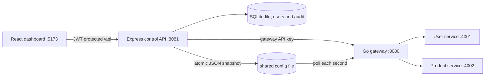
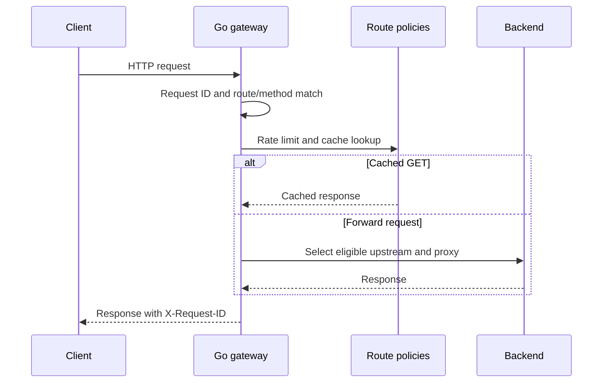
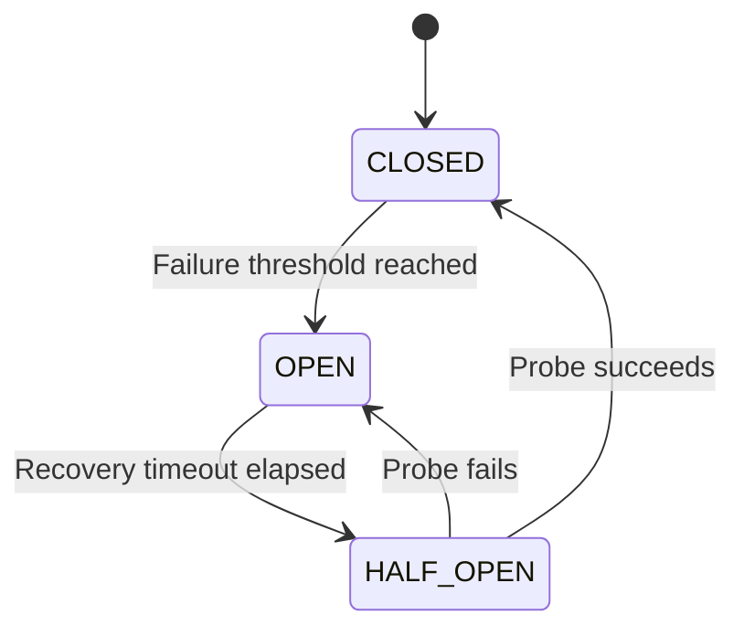

# Gatekeeper

**Smarter Traffic. Faster Responses. Reliable Systems.**

Gatekeeper is a local API gateway project. Manage routes in the React dashboard, persist them in SQLite, and publish a versioned JSON snapshot that the Go gateway loads while running.

It includes route and method matching, prefix rewriting, weighted upstreams, active health probes, bounded GET caching, per-IP fixed/adaptive rate limiting, request metrics, JWT dashboard sessions, ADMIN/VIEWER roles, a separate gateway API key, and SQLite audit history.

The submission milestone adds persisted configuration history and validated rollback, deterministic stable/canary upstream groups, a bounded sanitized request inspector, latency percentiles, per-route traffic summaries, and configurable live alert thresholds. It preserves the existing Go + Express + SQLite + React design and the Phase 6.1 reliability controls.

## Architecture



Request flow:



Circuit breaker:



## Stack

- Go standard library: reverse proxy, dynamic routing, request IDs, per-IP rate limits, in-memory GET caching, weighted round robin, health probes, and metrics.
- Node.js 24+: Express control API and built-in `node:sqlite` database.
- React, TypeScript, and Vite: responsive dashboard.
- Node.js sample user and product services.

No Docker, Kubernetes, Redis, PostgreSQL, Prisma, or orchestration is required.

## Requirements

- Windows 10/11 with PowerShell 7 recommended (Windows PowerShell 5.1 also supports the startup script).
- Go 1.23 or newer.
- Node.js 22.5 or newer (`node:sqlite`); Node 24 recommended.
- npm.

Node currently prints its experimental warning when the built-in `node:sqlite` module starts; SQLite persistence and the control API tests work normally.

Install JavaScript packages once from the repository root:

```powershell
npm install
```

## Start the application

From the repository root, start all five processes:

```powershell
./scripts/start-all.ps1
```

Open <http://localhost:5173>. Stop the started processes with `./scripts/stop-all.ps1`. Logs are written under `data/logs/`. Default ports are 8080 (gateway), 8081 (control API), 4001 (users), 4002 (products), and 5173 (dashboard). Configure them with `GATEWAY_LISTEN_ADDR`, `CONTROL_API_PORT`, `USER_SERVICE_PORT`, `PRODUCT_SERVICE_PORT`, and `VITE_PORT`. `SQLITE_FILE` and `GATEWAY_CONFIG_FILE` set the database and shared config file paths. Both services resolve relative paths from the project root. The startup script passes one shared configuration path to the API and gateway.

Set overrides in the current PowerShell session before startup, for example:

```powershell
$env:GATEWAY_LISTEN_ADDR = ':8090'
$env:CONTROL_API_PORT = '8091'
$env:USER_SERVICE_PORT = '4101'
$env:PRODUCT_SERVICE_PORT = '4102'
$env:VITE_PORT = '5174'
./scripts/start-all.ps1
```

For manual process-by-process startup, set the same secrets and paths in each PowerShell window. The all-in-one script above generates random secrets and configures every process consistently, so it is the recommended local workflow.

```powershell
$env:GATEWAY_API_KEY = '<same random secret of at least 32 characters>'
$env:JWT_SECRET = '<same random secret of at least 32 characters>'
$env:GATEWAY_TOKEN = $env:GATEWAY_API_KEY
$env:SQLITE_FILE = 'data/gatekeeper.sqlite'
$env:GATEWAY_CONFIG_FILE = 'data/gateway-config.json'
```

Then start processes in separate windows:

```powershell
go -C services/gateway run ./cmd/gateway
npm run dev --workspace @gatekeeper/control-plane
npm run dev --workspace @gatekeeper/dashboard
npm run start --prefix services/user-service
npm run start --prefix services/product-service
```

## Use the gateway

1. In **Services**, add `users` with upstream `http://localhost:4001`.
2. In **Routes**, create `/api/users`, select `PREFIX`, allow `GET, POST`, and leave prefix stripping disabled. Optionally configure requests per minute and cache TTL.
3. Add a `products` service and `/api/products` route at `http://localhost:4002`.

Example requests:

```powershell
Invoke-RestMethod http://localhost:8080/api/users
Invoke-RestMethod http://localhost:8080/api/products
Invoke-RestMethod -Method Post -Uri http://localhost:8080/api/users -ContentType 'application/json' -Body '{"name":"Katherine Johnson","email":"katherine@example.test"}'
Invoke-RestMethod http://localhost:8080/health
# Management metrics require a dashboard access token:
$session = Invoke-RestMethod -Method Post -Uri http://localhost:8081/api/auth/login -ContentType 'application/json' -Body '{"username":"<admin>","password":"<password>"}'
$headers = @{ Authorization = "Bearer $($session.accessToken)" }
Invoke-RestMethod http://localhost:8081/api/gateway/metrics -Headers $headers
Invoke-RestMethod http://localhost:8081/api/routes -Headers $headers
Invoke-RestMethod http://localhost:8081/api/gateway/health -Headers $headers
```

The gateway returns a request ID in `X-Request-ID`. An unmatched or disabled route returns 404; a matching path with a disallowed method returns 405.

## Control API

- `GET /health`
- `GET, POST /api/services`; `PUT /api/services/:id`
- `GET /api/upstreams`; `POST /api/services/:id/upstreams`; `PUT, DELETE /api/upstreams/:id`
- `GET, POST /api/routes`; `PUT, DELETE /api/routes/:id`
- `POST, DELETE /api/routes/:id/adaptive/override` (temporarily set a bounded rate or resume automatic control)
- `GET /api/gateway/config`, `/api/gateway/metrics`, `/api/gateway/health`, `/api/gateway/adaptive`, `/api/gateway/adaptive/history`, `/api/analytics`

Route fields include `path`, `matchMode` (`EXACT` or `PREFIX`), `methods`, `stripPrefix`, optional `rewritePrefix`, `timeoutMs`, `rateLimit` (requests/minute/IP, zero disables), `rateLimitMode` (`FIXED` or `ADAPTIVE`), adaptive bounds, `cacheTtlMs` (zero disables), `loadBalancingAlgorithm`, circuit-breaker settings, retry policy, `enabled`, and `serviceId`. Services may have multiple weighted upstream instances.

## Routing and traffic behavior

- The gateway selects the most specific matching path; exact routes win ties. Prefix matches stop at path boundaries (`/api/user` does not match `/api/users`).
- Route changes are stored in SQLite and published as a complete JSON snapshot using atomic rename. The gateway validates each snapshot before replacing its immutable active configuration; rejected snapshots leave the active version in place.
- Upstream selection supports weighted/unweighted round robin, least connections and least response time. Health probes run every five seconds and `/api/gateway/health` probes targets on demand. Failed instances and open circuits are skipped until eligible again. The gateway also stores a `.last-good` snapshot beside its shared config file.
- Rate limits use a concurrency-safe in-memory one-minute sliding window keyed by route and client IP. Client state is capped at 10,000 keys.
- Successful GET responses up to 2 MiB are cached per route and request URI for the configured TTL. Errors and responses with `Set-Cookie` are not cached. The cache is concurrency-safe and capped at 1,000 entries.
- Metrics come from live gateway requests and include requests/sec over a rolling ten-second window, average latency (milliseconds, shown to two decimals), server error rate, expected client errors, status-code distribution, cache hits/misses, and a 60-second time series. The dashboard refreshes gateway metrics and backend health every five seconds.
- The **Traffic Analytics** page charts request volume and average response time, breaks down status codes, and shows each configured upstream's latest health probe result. It uses the same live gateway metrics and route configuration as the overview.

## Adaptive rate limiting

Routes default to **FIXED**, preserving the configured one-minute requests-per-IP window. To enable adaptation, edit a route, select **ADAPTIVE**, set its base rate, minimum and maximum, sensitivity, and cooldown, then enable adaptive enforcement. The maximum must be at least the base rate; the minimum cannot exceed the base. Legacy routes migrate as FIXED and keep their current rate limit.

The engine records route traffic in rolling five-second buckets and keeps a 12-bucket (60-second) EWMA baseline. For the first three evaluation windows the baseline is considered unready, so the configured base limit remains in force. After warmup, a window is a spike when it contains at least 10 requests and its rate is strictly greater than `spikeSensitivity × baseline`. Defaults are sensitivity `2.0`, five-second evaluation, 10 requests per spike window, 25% reduction, minimum 20% of base (rounded up), maximum the base, and 30-second recovery cooldown. Traffic state is evaluated every five seconds. After stable traffic through the cooldown, recovery starts and increases by 5% of the base (at least one request/minute) every cooldown period. The dashboard shows actual baseline and incoming traffic, effective limit, throttles, state, last adaptation, and the latest 500 decision explanations.

Administrators can temporarily override a route's effective limit from **Adaptive Protection**. Overrides must remain between the route's configured minimum and maximum and expire after 1–86,400 seconds. Removing an override resumes automatic control. Every route change, override, spike, reduction, and recovery adjustment is applied through the same versioned snapshot reload without restarting Go. `X-RateLimit-Limit`, `X-RateLimit-Remaining`, and `X-RateLimit-Mode` accompany limited route responses; rejected requests include `Retry-After` and a JSON reason.

The engine intentionally keeps traffic baselines, effective limits, and audit events in gateway memory. A gateway restart begins a fresh baseline warmup. This in-memory limiter does not coordinate limits across multiple gateway processes. Recovery advances when traffic is evaluated on subsequent requests.

## Fault tolerance and request handling

Circuit breakers are maintained independently for each route and upstream URL. They default to disabled; when enabled, the default policy opens after five consecutive connection failures, timeouts, or upstream 5xx responses, then waits 30 seconds before allowing one half-open probe. A successful probe closes the circuit; a failed probe reopens it. Ordinary upstream 4xx responses and gateway rate-limit responses do not count as failures. Health probes continue to detect backend recovery. The **Gateway Health** page polls live protected gateway metrics and shows each target's circuit state, failures, active requests, average response time, configured balancing algorithm, retry counters, and recent circuit transitions.

Retries default to zero attempts; when retries are enabled the control API defaults to a 50 ms initial backoff, 1 second cap, no jitter, no status retries until selected, and disabled connection/timeout retries. Configure up to five attempts per route, exponential backoff and optional jitter, retryable 5xx codes, connection-error retries, and timeout retries. Retries share the route's total request deadline and stop on client cancellation. GET, HEAD, OPTIONS, PUT, DELETE, and TRACE are treated as idempotent. POST, PATCH, and other methods are not retried unless **Allow unsafe method retries with Idempotency-Key** is enabled and the request supplies that header. Replayable request bodies are buffered up to 4 MiB only when retry is enabled. A retrying request never resends after a response has been committed to the client.

Each route selects one load-balancing algorithm: `ROUND_ROBIN`, `WEIGHTED_ROUND_ROBIN` (the backward-compatible default), `LEAST_CONNECTIONS`, or `LEAST_RESPONSE_TIME`. Selection excludes health-probe failures and open circuits. If no target is eligible, the gateway returns 502 without falling back to a different algorithm.

Example route settings in the versioned gateway snapshot (the control API writes the same fields from the Routes page):

```json
{
  "loadBalancingAlgorithm": "LEAST_CONNECTIONS",
  "circuitBreakerEnabled": true,
  "circuitFailureThreshold": 5,
  "circuitRecoveryTimeoutMs": 30000,
  "circuitHalfOpenProbes": 1,
  "maxRetries": 2,
  "retryBackoffMs": 50,
  "retryMaxBackoffMs": 1000,
  "retryJitter": true,
  "retryStatuses": [502, 503, 504],
  "retryConnectionErrors": true,
  "retryTimeouts": true,
  "retryNonIdempotent": false
}
```

Bounds are validated before SQLite commits a route update or the gateway replaces its active snapshot. Legacy routes default to weighted round robin, disabled circuit breaking, and no retries. Runtime counters and circuit state are in-memory and reset when the gateway restarts; configuration persists in SQLite and snapshots. The event list is bounded to the latest 500 transitions. Least-response-time uses a simple 7/8 EWMA of time to upstream response headers, so it does not model full response-body transfer time. Retries can increase backend load, so use low attempt counts and keep the backoff within the request deadline.

The existing authenticated `GET /api/routes` and route create/update APIs store these settings in SQLite and publish the next snapshot version. `GET /api/gateway/metrics` returns live counters plus `upstreams.upstreams` and `upstreams.circuitEvents`; the Express endpoint uses dashboard JWT/RBAC and the Go metrics endpoint is protected by the gateway API key. The gateway permits at most 100 upstream instances per route and 1,000 routes per snapshot.

## Reliability and performance checks

The gateway tests exercise per-client/per-route sliding-window limits (including the JSON 429 and `Retry-After`), cache hit/expiry/configuration invalidation and exclusions, configuration reload, concurrent traffic, weighted and unweighted round robin, least-connections and least-response-time selection, health and circuit exclusion, circuit transitions/recovery/isolation, retry status and connection behavior, body replay, cancellation/deadlines, and upstream failure handling.

Run the automated checks from the repository root in PowerShell:

```powershell
$env:GOCACHE = Join-Path (Get-Location) '.gocache'
go -C services/gateway test ./...
go -C services/gateway vet ./...
npm run test:control-api
npm run test:sample-services
npm run test:integration
npm run typecheck --workspace @gatekeeper/control-plane
npm run lint --workspace @gatekeeper/control-plane
npm run typecheck --workspace @gatekeeper/dashboard
npm run lint --workspace @gatekeeper/dashboard
npm run build --workspace @gatekeeper/dashboard
npm run format:check
```

On Windows, the Go race detector requires cgo and a supported C compiler such as MinGW-w64 GCC:

```powershell
$env:CGO_ENABLED = '1'
go -C services/gateway test -race ./...
```

For a repeatable cache-on/cache-off load comparison, start the app with `./scripts/start-all.ps1`, create and enable a route in the dashboard, and copy its ID from the Routes page/API. The load runner works in Windows PowerShell 5.1 and PowerShell 7:

```powershell
./scripts/load-test.ps1 -RouteId '<route-id>' -Iterations 500 -Concurrency 20
```

The script reports requests/sec, average and P50/P95/P99 latency, non-2xx error rate, and gateway cache hit/miss deltas for both modes. It prompts for administrator login if `GATEKEEPER_TEST_USERNAME` and `GATEKEEPER_TEST_PASSWORD` are not set. It temporarily disables rate limiting for the selected route and restores its prior route settings even if the run fails. Optional parameters are `-CacheTtlMs`, `-ControlApiUrl`, and `-GatewayUrl`.

To reproduce the adaptive traffic burst and recovery scenario, start the app, identify two routes (the script uses one user route and one independent route), then run:

```powershell
$routes = Invoke-RestMethod http://localhost:8081/api/routes
$users = $routes | Where-Object path -eq '/api/users' | Select-Object -First 1
$products = $routes | Where-Object path -eq '/api/products' | Select-Object -First 1
./scripts/test-adaptive.ps1 -RouteId $users.id -OtherRouteId $products.id
```

The script temporarily sets a 20/minute base, establishes four baseline samples, sends a 15-request burst from an isolated loopback client, checks spike detection, the reduced limit and 429 response, verifies the product route, then measures each recovery step back to 20/minute. It restores the selected route's original configuration in `finally`.

## Checks

```powershell
go -C services/gateway test ./...
go -C services/gateway vet ./...
npm run test:control-api
npm run test:sample-services
npm run typecheck --workspace @gatekeeper/dashboard
npm run lint --workspace @gatekeeper/dashboard
npm run typecheck --workspace @gatekeeper/control-plane
npm run lint --workspace @gatekeeper/control-plane
npm run build --workspace @gatekeeper/dashboard
```

## Project layout

```text
apps/dashboard/                 React + Vite dashboard
services/gateway/               Go gateway and tests
services/control-plane/         Express API and SQLite persistence
services/user-service/          Sample user API (:4001)
services/product-service/       Sample product API (:4002)
scripts/start-all.ps1            Windows all-in-one startup
scripts/load-test.ps1             Cache enabled/disabled load comparison
scripts/test-adaptive.ps1          Adaptive spike, throttle, and recovery verification
data/                            Local database and gateway snapshot
```

## Phase 5: production-readiness checks

The repository already includes gateway tests for exact/prefix routing, methods and rewriting, cache hits/expiry/invalidation/exclusions, metrics, fixed and adaptive throttling, concurrent access, weighted upstream selection, backend health failure/recovery, timeout behavior, configuration validation/reload, request logging, and graceful shutdown. Control API tests cover SQLite persistence, configuration publishing, validation, bcrypt/JWT behavior, ADMIN/VIEWER permissions, gateway API-key checks, login throttling, logout revocation, and audit history. Sample-service tests cover valid and invalid resource requests.

The live integration acceptance script exercises the cross-process behavior that unit tests cannot establish. It generates temporary test credentials, uses a private temporary database/configuration and dynamically allocated ports, starts the gateway/control API/dashboard/sample services, verifies authenticated management and real forwarding, exercises cache/rate-limit/adaptive behavior and backend recovery, restarts the control API, and checks session/configuration persistence. Successful runs clean their temporary directory. Failed runs retain their logs for diagnosis. It does not edit the normal `data/gatekeeper.sqlite` database or stop the normal process list.

Run the same checks locally on Windows:

```powershell
$env:GOCACHE = Join-Path (Get-Location) '.gocache'
go -C services/gateway test ./...
go -C services/gateway vet ./...
npm run test:control-api
npm run test:sample-services
npm run lint --workspace @gatekeeper/control-plane
npm run typecheck --workspace @gatekeeper/control-plane
npm run lint --workspace @gatekeeper/dashboard
npm run typecheck --workspace @gatekeeper/dashboard
npm run build --workspace @gatekeeper/dashboard
npm run format:check
./scripts/test-integration.ps1
```

`tests/integration/acceptance.ps1` remains as an alias for the integration command. The CI workflow at `.github/workflows/ci.yml` runs Go tests/vet, Node and sample-service tests, dashboard lint/typecheck/build, and the isolated end-to-end suite on `windows-latest` with Go 1.23 and Node 24. No repository or GitHub secrets are used by CI.

The load runner compares cache-on and cache-off behavior and prints requests/sec, average latency, P50, P95, P99, errors, and cache counters. Use the same machine, route, iteration count, and concurrency when comparing runs. The local sample services and small request counts are useful for regression checks only; they do not establish production throughput or capacity. Latency includes local process scheduling and loopback networking. The current rate limiter, response cache, health state, and adaptive baseline are in memory per gateway process; none is coordinated across multiple gateway instances. Windows Go race tests require a C compiler with cgo enabled, which is not installed in every development environment.

To demonstrate circuit opening and recovery manually, start Gatekeeper and configure an enabled user route in **Routes** with circuit breaking enabled, failure threshold `1`, recovery timeout `5000` ms, and one or more upstream instances. Authenticate to the control API, then stop the user service using its recorded process ID:

```powershell
. ./scripts/auth.ps1
$token = Get-GatekeeperAccessToken
$processes = Get-Content data/gatekeeper-processes.json -Raw | ConvertFrom-Json
$userProcess = $processes | Where-Object name -eq 'user-service' | Select-Object -First 1
Stop-Process -Id $userProcess.id -Force
try { Invoke-WebRequest http://localhost:8080/api/users } catch { $_.Exception.Response.StatusCode }
$headers = @{ Authorization = "Bearer $token" }
(Invoke-RestMethod http://localhost:8081/api/gateway/metrics -Headers $headers).upstreams.upstreams |
  Where-Object routeId -eq '<user-route-id>' | Format-Table upstream,circuitState,consecutiveFailures
```

Restart the sample backend and issue health probes and gateway requests until the circuit closes:

```powershell
$oldPort = $env:PORT
$env:PORT = '4001'
$recoveredService = Start-Process node.exe -WindowStyle Hidden -PassThru -WorkingDirectory (Join-Path (Get-Location) 'services/user-service') -ArgumentList 'src/main.js'
if ($null -eq $oldPort) { Remove-Item Env:PORT } else { $env:PORT = $oldPort }
1..20 | ForEach-Object {
  Invoke-RestMethod http://localhost:8081/api/gateway/health -Headers $headers | Out-Null
  try { Invoke-RestMethod http://localhost:8080/api/users | Out-Null } catch { }
  Start-Sleep -Milliseconds 500
}
(Invoke-RestMethod http://localhost:8081/api/gateway/metrics -Headers $headers).upstreams.circuitEvents |
  Where-Object routeId -eq '<user-route-id>' | Select-Object at,from,to,reason
Stop-Process -Id $recoveredService.Id -Force
```

For automated failure, failover, half-open recovery, and config-reload coverage, run `./scripts/test-integration.ps1`; it uses isolated temporary ports and a temporary SQLite database.

## Security and access control

Before the first start, create the initial administrator (the command prompts for a username and twice for a password; passwords must be 12�128 characters):

```powershell
./scripts/create-admin.ps1
./scripts/start-all.ps1
```

The setup script stores only a bcrypt password hash in the existing SQLite database. It refuses to create a second initial administrator; administrators can create ADMIN or VIEWER accounts in the dashboard's **Access Control** page. ADMIN may change configuration and accounts. VIEWER can inspect routes, services, metrics, health, and gateway configuration; the API returns HTTP 403 for viewer mutations.

Dashboard login is `POST /api/auth/login`; it returns a signed HS256 JWT that expires after 15 minutes. The dashboard keeps the short-lived token in session storage, calls the authenticated logout endpoint, and returns to login when a token expires or is revoked. Five invalid login attempts per username and client address are throttled for 15 minutes. `GET /health` and the public data-plane routes remain available without dashboard login.

`GATEWAY_API_KEY` authenticates the Go gateway's internal configuration, acknowledgement, runtime-health, and metrics endpoints. It is distinct from dashboard passwords and `JWT_SECRET`; neither secret is returned to the browser or written to request/audit logs. The local startup script generates random 256-bit values for either secret that is not already set in the current PowerShell environment. Set `GATEWAY_API_KEY` and `JWT_SECRET` explicitly for a stable deployment. Both must be at least 32 characters/bytes respectively. `DASHBOARD_ORIGINS` is a comma-separated allowlist for browser origins (default local Vite origin). The Express API sets security headers, accepts JSON request bodies up to 64 KiB, and returns sanitized errors.

The API requires `JWT_SECRET` and `GATEWAY_API_KEY` to each contain at least 32 bytes at startup. The API migrations add user, session, acknowledgement, and audit tables without dropping route/service state. Audit entries include actor, action, resource, timestamp, and allowlisted non-sensitive configuration fields. `GET /api/access/audit` is ADMIN-only. Access control endpoints are `GET, POST /api/access/users`, `PATCH /api/access/users/:id`, and `GET /api/access/audit`.

## Submission milestone features

- **Configuration history:** `config_history` stores validated snapshots with actor, timestamp, summary, and rollback reference. `GET /api/config/history`, `GET /api/config/history/:version`, and `GET /api/config/history/compare?from=1&to=2` are read endpoints; ADMIN-only `POST /api/config/rollback/:version` validates and republishes the selected configuration as a new version. Snapshot secrets are not included.
- **Canary traffic:** route `upstreamGroups` define named percentage groups whose integer weights must total 100. The gateway deterministically selects a group and uses its route load-balancing algorithm; unhealthy/circuit-open groups fall through to the next configured eligible group. Configure groups in Routes JSON or in Canary Deployments. For distinct versions, register separate upstream instances first.
- **Request inspection:** `/api/gateway/requests` and `/api/gateway/requests/:requestId` are proxied by the authenticated control API. The Go gateway retains only the last 1,000 sanitized request records in memory; it never stores headers or bodies. Filter query parameters include `route`, `status`, `upstream`, `requestId`, and `limit`.
- **Analytics and alerts:** gateway metrics include P50/P95/P99 from the retained sample window, live RPS, error/status counts, cache counts and route counters. `/api/alerts` evaluates configured error-rate, P95 latency, traffic-spike, unhealthy-backend, and OPEN-circuit conditions; alerts and acknowledgements persist in SQLite. ADMIN can change `/api/alerts/rules` and acknowledge an active alert.

### Additional documentation

- [Architecture and request lifecycle](docs/architecture.md)
- [API reference](docs/API_REFERENCE.md)
- [Security model](docs/SECURITY.md)
- [Test and benchmark instructions](docs/TESTING.md)
- [Demonstration guide](docs/DEMO_GUIDE.md)
- [Project submission report](docs/PROJECT_SUBMISSION.md)

### Demo and test commands

The isolated demonstration uses temporary SQLite/config files and generated throwaway credentials:

```powershell
./scripts/demo-gatekeeper.ps1
```

Run the API suite including config history and rollback:

```powershell
npm run test:control-api
```

Run end-to-end checks for snapshot reload, canary group persistence, request inspector, both sample backends, cache/rate-limit/adaptive behavior, circuit failure/recovery, RBAC, audit, and control-plane restart:

```powershell
./scripts/test-integration.ps1
```

### Screenshots

Add screenshots captured from a running local application here before final submission. Suggested views: Overview, Routes, Configuration History, Canary Deployments, Request Inspector, Analytics & Alerts, and Gateway Health. No example screenshots are included because this repository has not captured verified application images.

### Known limitations

Gateway cache/rate-limit/adaptive/circuit/health/request history is process-local and resets on restart. Percentile and per-route request summaries use the bounded 1,000-request in-memory sample, while basic gateway totals/counters are process-local cumulative counters. Canary assignment is deterministic per route counter and not sticky per client. Alerts are evaluated during API/dashboard polling, so an alert is created/resolved when a poll observes the condition. Local measurements do not imply production throughput.

### Database overview

SQLite stores user hashes and sessions, services/upstreams, routes and adaptive overrides, gateway acknowledgements, audit events, configuration snapshots/history, alert thresholds/history, and control API request summaries. Migrations add missing columns and tables in place; the isolated test suites use temporary database files.

### Local load-test observation

The integration run captured one small comparison on this Windows development environment (80 requests per mode, concurrency 8, loopback sample service):

| Cache mode |    RPS | Mean ms | P50 ms | P95 ms | P99 ms | Errors | Cache hits |
| ---------- | -----: | ------: | -----: | -----: | -----: | -----: | ---------: |
| Enabled    | 831.95 |    6.67 |   6.42 |   7.92 |  11.85 |      0 |         79 |
| Disabled   | 817.97 |    9.12 |   7.74 |  20.50 |  28.88 |      0 |          0 |

This is a single small local run, not a capacity benchmark. Windows CIM denied access to CPU and memory inventory during this session, so hardware model/RAM could not be captured. Loopback networking, OS scheduling, Vite/Node/Go process startup and low request count dominate these measurements; do not generalize them to production. Use `scripts/load-test.ps1` for repeatable comparisons on a documented machine.

To run the verification commands in PowerShell:

```powershell
$env:GOCACHE = Join-Path (Get-Location) '.gocache'
go -C services/gateway test ./...
go -C services/gateway vet ./...
npm run test:control-api
npm run test:sample-services
npm run typecheck --workspace @gatekeeper/control-plane
npm run lint --workspace @gatekeeper/control-plane
npm run typecheck --workspace @gatekeeper/dashboard
npm run lint --workspace @gatekeeper/dashboard
npm run build --workspace @gatekeeper/dashboard
```
