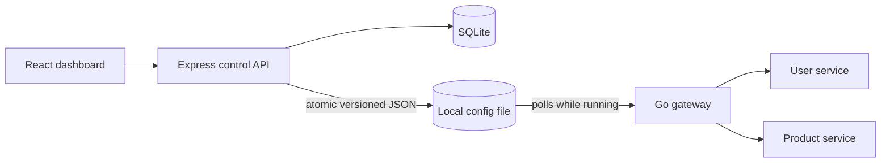

# Gatekeeper architecture

Gatekeeper keeps the local project small: React/Vite provides the management UI, Express owns route and service configuration in SQLite, and Go handles API traffic.

The control API updates SQLite, builds a complete snapshot, and atomically replaces the shared file. The gateway checks that file each second. It validates the full snapshot and swaps an immutable in-memory copy only after validation and persistence succeed. Invalid updates leave the active configuration in service.

The gateway matches exact or segment-boundary prefix paths, checks HTTP methods, rewrites paths when configured, applies route deadlines and per-IP request limits, and selects weighted upstreams. A failed upstream is skipped after a connection error until a later successful health probe clears the failure. Successful GET responses can use a bounded TTL cache.

The gateway remains useful if the control API stops after the last accepted snapshot has been stored. Configuration and route metadata persist in SQLite; gateway runtime metrics and caches are in memory. The user and product fixtures reset when their sample services restart.

See the root [README](../README.md) for setup commands, endpoints, configuration, and checks.
