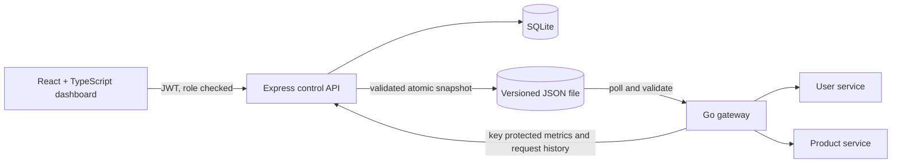
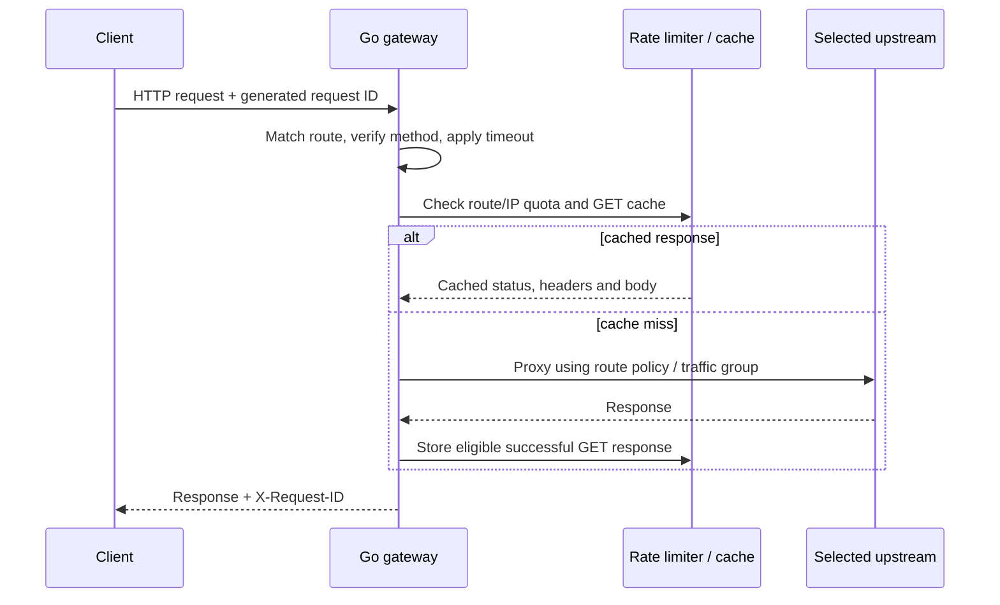
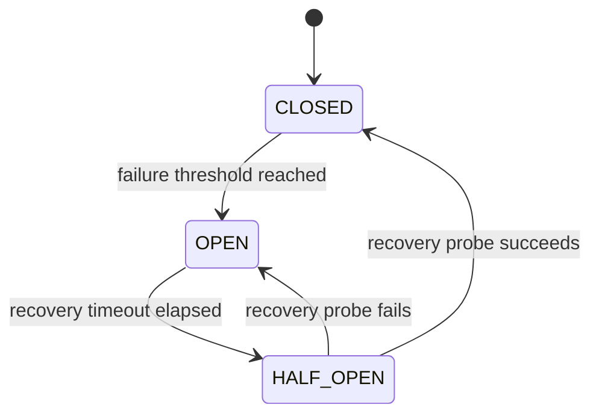

# Gatekeeper Architecture

Gatekeeper keeps its existing single-machine architecture. Express owns persistent control-plane configuration in SQLite, the Go standard-library gateway handles data-plane traffic, and the React/Vite dashboard manages the application through authenticated APIs.

The control API updates SQLite, builds a complete versioned snapshot, and atomically replaces the shared local configuration file. The Go gateway checks that file periodically, validates the complete snapshot and swaps an immutable in-memory copy only when validation and persistence succeed. Invalid updates leave the last-known-good configuration serving traffic.

The gateway matches exact or segment-boundary prefix paths, enforces HTTP method restrictions, rewrites paths when configured, applies route deadlines and per-IP request limits, and selects weighted upstreams. Health probes exclude failed instances. Circuit breakers isolate failures per upstream, bounded retries respect method safety and request deadlines, and successful GET responses can use a bounded TTL cache.

The gateway can continue serving the last accepted snapshot if the control API stops. Configuration, account, audit, and alert data persist in SQLite; gateway counters, cache entries, rate-limit windows, adaptive baselines, circuit state, and request inspection history are process-local. Sample-service fixture records reset when the sample processes restart.

For local setup, API endpoints, verification commands, and operating instructions, see the root [README](../README.md) and [API reference](API_REFERENCE.md).

## Configuration publication

Mutations are authenticated and ADMIN-only. The control API validates input, updates SQLite, constructs a complete snapshot with a monotonically increasing version, atomically renames a temporary JSON file into place, and stores a non-secret historical copy with actor and summary. The gateway polls the file, validates it, writes its last-known-good backup, then atomically replaces its immutable snapshot. A failed validation does not displace the running configuration. Rollback creates a new version from a previously validated snapshot rather than moving the active version backwards.

Canary groups are part of each route snapshot. A deterministic route-level counter assigns each request to the configured percentage range. The gateway balances among healthy instances within the selected group; if that group has no healthy/circuit-eligible target, it tries the other configured groups in deterministic order.

## Runtime observations

Gateway request history is a bounded in-memory ring (1,000 sanitized records). Latency percentiles are calculated from that window; route request and error totals also reflect that bounded window. Cumulative metrics, cache and rate-limit state are process-local. Circuit and adaptive histories are separately bounded. Alert rules and alert history are persisted in SQLite; the control API evaluates them from live metrics and health polling.

## Limits

This is a locally runnable B.Tech project, not a distributed gateway deployment. In-memory rate limits, cache, health probes, circuit state, and telemetry are not shared between gateway processes and reset on restart. Traffic group assignment is deterministic weighted percentage scheduling, not sticky session assignment. Local loopback benchmarks cannot predict production capacity.
